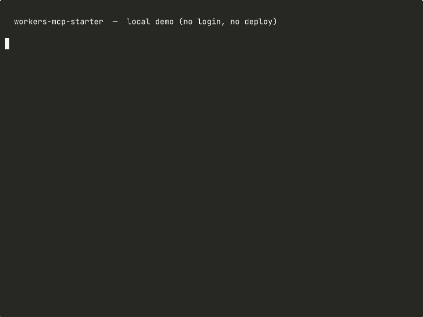
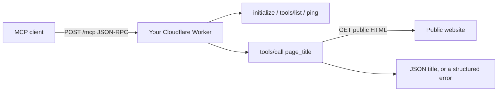

# workers-mcp-starter

[](LICENSE)
[](https://github.com/getgofetch/workers-mcp-starter/actions/workflows/test.yml)
[](package.json)

A small, dependency-free [Model Context Protocol](https://modelcontextprotocol.io/) server that runs on a [Cloudflare Worker](https://developers.cloudflare.com/workers/). It speaks stateless Streamable HTTP at `POST /mcp`, ships one example tool, and has tests that run with `node --test` (no wrangler required for the tests).

This is a starter you deploy on your own account. It is useful on its own if you want to see a working remote MCP server without a framework. It is not a hosted service.

[](https://deploy.workers.cloudflare.com/?url=https://github.com/getgofetch/workers-mcp-starter)

The button opens the official Cloudflare deploy flow against [getgofetch/workers-mcp-starter](https://github.com/getgofetch/workers-mcp-starter) and deploys a copy to **your** account. It needs a public GitHub repo, so it will only work once this repository is public.



## 30-second quickstart

You need Node 18 or later. Wrangler 4 is only required if you want a local server or a deploy.

```bash
git clone https://github.com/getgofetch/workers-mcp-starter
cd workers-mcp-starter
npm install
npm test
npx wrangler dev --local
```

In another terminal:

```bash
curl -sS http://127.0.0.1:8787/health

curl -sS http://127.0.0.1:8787/mcp \
  -H "content-type: application/json" \
  -d '{"jsonrpc":"2.0","id":1,"method":"initialize","params":{"protocolVersion":"2025-03-26","capabilities":{},"clientInfo":{"name":"curl","version":"0"}}}'

curl -sS http://127.0.0.1:8787/mcp \
  -H "content-type: application/json" \
  -d '{"jsonrpc":"2.0","id":2,"method":"tools/call","params":{"name":"page_title","arguments":{"url":"https://example.com"}}}'
```

Point an MCP client at `http://127.0.0.1:8787/mcp`. A sample Cursor config is in `.mcp.json`. After you deploy, change that URL to your Worker origin.

## What you get

- `POST /mcp` — `initialize`, `ping`, `tools/list`, `tools/call`, and notification acks
- `GET /health` and `GET /` — liveness and a short discovery payload
- `page_title` — fetch a public http(s) page and return its HTML `<title>` (static HTML only; private and local addresses are rejected)
- A Cursor rule and a short skill for building MCP servers on Workers
- Offline tests

There is no authentication and no rate limiting in this starter. Do not put a private tool behind it until you add those.

## How it fits together



The Worker is stateless. It may echo an `mcp-session-id` header. It does not store sessions, and `GET /mcp` is not implemented (no SSE stream): POST a JSON-RPC body instead.

## Deploy

The [Deploy to Cloudflare](https://deploy.workers.cloudflare.com/?url=https://github.com/getgofetch/workers-mcp-starter) button is the short path once this repo is public. From a checkout, the manual path is:

```bash
npx wrangler login          # your own Cloudflare account, when you are ready
npx wrangler deploy
```

The starter is aimed at the Workers Free plan. Check Cloudflare's current limits before you rely on them. `npm test` should be green before you deploy. This repository will not deploy anything for you.

## Replace the example tool

Search the repo for `REPLACE THIS`. Keep this order in the handler:

1. Validate input and return a structured error. Do not call the network on bad input.
2. Do the work. The example reads static HTML only. It does not render JavaScript and it will not try to get around a bot wall.
3. Update `TOOLS` in `src/tools.js` so `tools/list` matches the new behaviour.

## Pro version

This starter is the cut-down, open-source piece. Paid kits add API-key and JWT checks, Durable Object rate limits, a fuller set of Workers / MCP agent skills, a self-hosted page extractor, and related starters.

The lot is listed together here (US$99 everything bundle, or buy a kit on its own):

https://getgofetch.dev/kits

Until that page is live and the store is approved, there is nothing to buy. Checkout links on that page stay as placeholders until then.

## FAQ

**Is this a hosted MCP server?**
No. You clone it and deploy it on your own Cloudflare account. There is no shared getgofetch endpoint for this starter.

**Do I need a paid Cloudflare plan?**
No. It is aimed at the Workers Free plan. Recheck Cloudflare's current limits before you rely on them.

**Why is there no API key?**
So the first deploy is honest and small. Add a check in the Worker, before `tools/call` runs, if you hang anything private on it. The paid API-key / JWT kit on https://getgofetch.dev/kits is the worked example of that.

**Which MCP protocol versions are supported?**
`2025-06-18`, `2025-03-26` and `2024-11-05`. If the client asks for one of those, it is echoed back; otherwise the server uses `2025-03-26`.

**Will this work with Claude, Cursor or similar clients?**
Yes, if the client can call a remote Streamable HTTP endpoint. After deploy, add `https://your-worker.workers.dev/mcp` (or your own domain) as the server URL.

**What happens if I point page_title at localhost or a private address?**
The tool rejects it and does not fetch. That is a starter-level guard, not a complete production policy.

**Is support included?**
No support is promised. The files are provided as is, with no warranty and no obligation to update them when the MCP spec or Cloudflare's APIs change. Check the official docs before you ship.

## Licence

MIT. See `LICENSE`.
